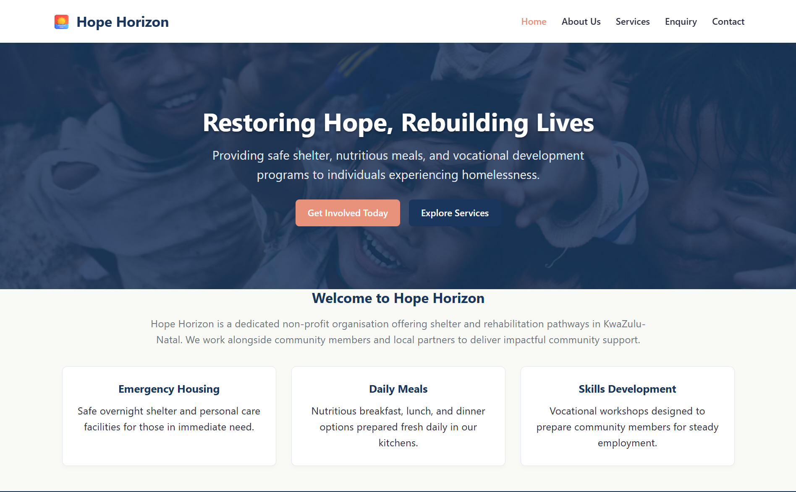
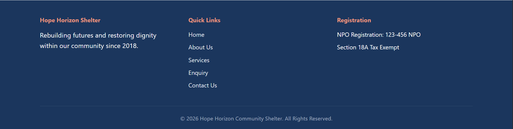
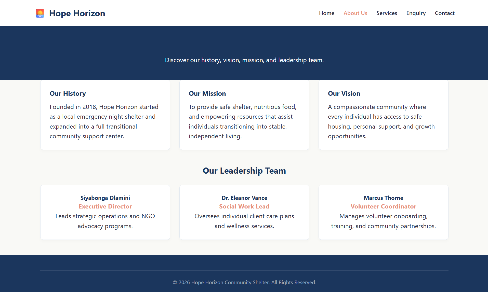
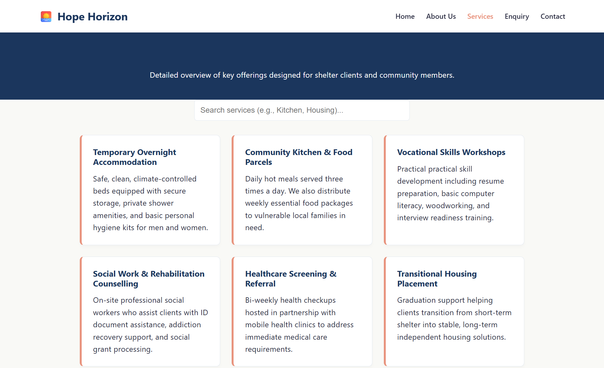
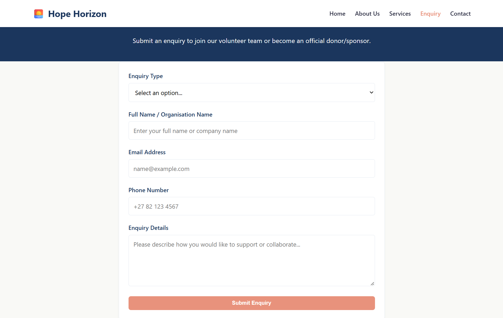
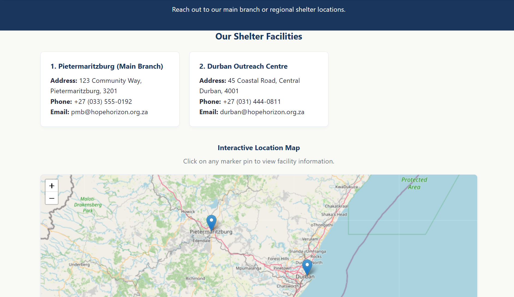
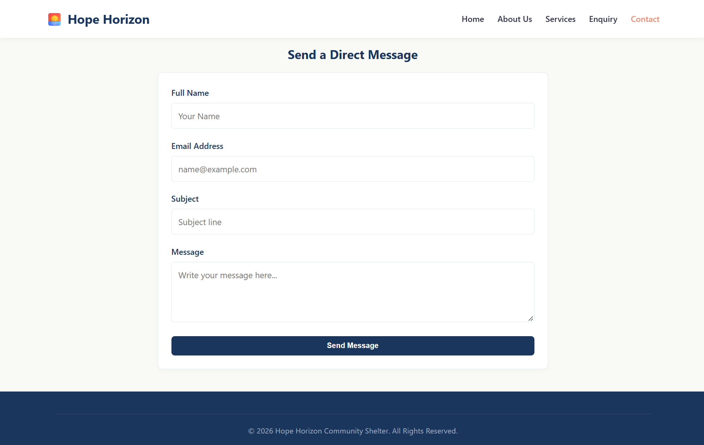

# Hope Horizon Community Shelter — Website Portfolio (PoE)

**Student Name:** [Ammiel Singh]  
**Student ID:** ST10470753  
**Module:** Web Development (WEDE5020)  
**Live Site URL:** https://st10470753.github.io/WEDEPOE/  
**GitHub Repository:** https://github.com/ST10470753/WEDEPOE  

---

## Project Overview
Hope Horizon Community Shelter is a non-profit organization (NPO) platform designed to support vulnerable community members in Pietermaritzburg and Durban, South Africa. The site provides details on shelter services, emergency housing, community meal programs, vocational workshops, and interactive contact channels.

---

## Key Website Features
* **Multi-Page Layout:** Structured 5-page design (`index.html`, `about.html`, `services.html`, `enquiry.html`, `contact.html`) linked with a unified external stylesheet (`styles.css`).
* **Interactive Map API:** Powered by Leaflet.js and OpenStreetMap to display interactive dual-location map pins for Pietermaritzburg and Durban branches.
* **Real-Time Search Filtering:** Dynamic JavaScript search bar on the Services page enabling instantly filtered results.
* **Custom Lightbox Gallery:** Interactive photo modal popups for shelter program images.
* **Form Validation & Error Handling:** Scripted validation preventing empty submissions and giving instant user status feedback.
* **SEO Optimization:** Configured with semantic HTML5 tags, meta descriptions, `robots.txt`, and XML sitemap (`sitemap.xml`).

---

## Website Screenshots & Previews

### 1. Home Page (`index.html`)



### 2. About Us Page (`about.html`)


### 3. Services Page (`services.html`)



### 4. Enquiry Page (`enquiry.html`)


### 5. Contact Page (`contact.html`)



---

## Technical Features & Implementation Summary

### 1. Interactive Dual-Location Map
* **Technology:** Leaflet.js API & CartoDB / OpenStreetMap Tiles.
* **Implementation:** Embedded dynamic JavaScript mapping script initializing map views over KwaZulu-Natal coordinates (`[-29.72, 30.70]`) with custom interactive marker popups for Pietermaritzburg and Durban shelter locations.

### 2. Real-Time Search Filtering
* **Technology:** Vanilla JavaScript (DOM Manipulation & Text Normalization).
* **Implementation:** `filterServices()` function utilizing the `onkeyup` event listener to compare lowercased user queries against service card text strings (`innerText`), dynamically toggling CSS display properties (`""` vs `"none"`).

### 3. Image Lightbox Modal
* **Technology:** Vanilla JavaScript & CSS Overlay UI Patterns.
* **Implementation:** `openImageLightbox()` and `closeImageLightbox()` functions triggering full-screen modal overlays upon image click events, dynamically updating the target image source attribute.

### 4. Form Validation & Error Handling
* **Technology:** Vanilla JavaScript Event Handling & Form Validation.
* **Implementation:** `handleContactSubmit()` function interrupting default submission (`event.preventDefault()`), checking for empty string inputs (`.trim() === ""`), providing visual color-coded alert notifications, and gracefully handling invalid user inputs.

---

## References

1. **Leaflet.js Mapping Library:**  
   Agafonkin, V. (2024). *Leaflet: An open-source JavaScript library for mobile-friendly interactive maps*. Available at: https://leafletjs.com/ (Accessed: 9 November 2026).

2. **OpenStreetMap Foundation:**  
   OpenStreetMap Contributors. (2024). *OpenStreetMap API and Tile Services*. Available at: https://www.openstreetmap.org/ (Accessed: 9 November 2026).

3. **JavaScript DOM Manipulation & Search Filtering:**  
   MDN Web Docs. (2024). *Element.innerHTML, innerText, and DOM Filtering Techniques*. Mozilla Developer Network. Available at: https://developer.mozilla.org/en-US/docs/Web/API/Document_Object_Model (Accessed: 9 November 2026).

4. **Client-Side Form Validation & Error Handling:**  
   MDN Web Docs. (2024). *Client-side form validation and event processing*. Mozilla Developer Network. Available at: https://developer.mozilla.org/en-US/docs/Learn/Forms/Sending_forms_through_JavaScript (Accessed: 9 November 2026).

5. **Modal Image Lightbox Pattern:**  
   W3Schools. (2024). *How to Create a Lightbox / Modal Image Gallery with CSS and JavaScript*. W3Schools Online Web Tutorials. Available at: https://www.w3schools.com/howto/howto_js_lightbox.asp (Accessed: 9 November 2026).

6. **Responsive Web Design Standards:**  
   W3C. (2023). *CSS Flexible Box Layout Module Level 1 & Grid Layout*. World Wide Web Consortium. Available at: https://www.w3.org/TR/css-flexbox-1/ (Accessed: 9 November 2026).

---

## Technology Stack
* **HTML5:** Semantic site layout and metadata.
* **CSS3:** Responsive Flexbox and Grid layouts styled with a Navy/Amber/Off-white brand palette.
* **JavaScript (ES6):** Leaflet.js mapping, search filtering, error validation, and lightbox controls.
* **Deployment:** GitHub Pages.

---

## Folder Structure
```text
WEDEPOE/
├── index.html
├── about.html
├── services.html
├── enquiry.html
├── contact.html
├── styles.css
├── robots.txt
├── sitemap.xml
├── README.md
└── images/
    ├── shelter1.jpg
    ├── shelter2.jpg
    ├── shelter3.jpg
    └── screenshots/
        ├── home-preview.png
        ├── home-extra.png
        ├── about-preview.png
        ├── services-preview.png
        ├── services-extra.png
        ├── enquiry-preview.png
        ├── contact-preview.png
        └── contact-extra.png# WEDEPOE
